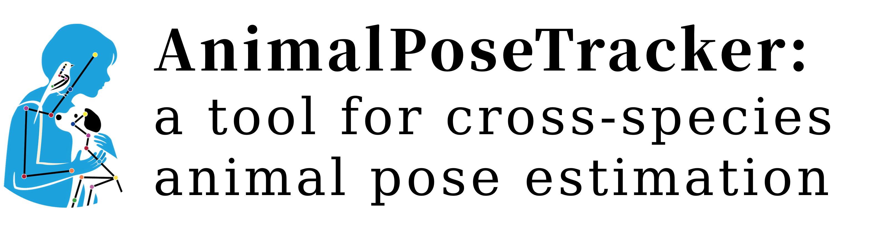
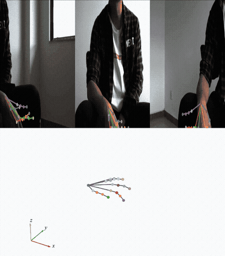
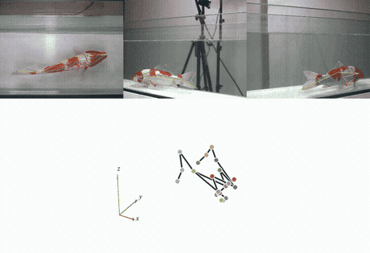
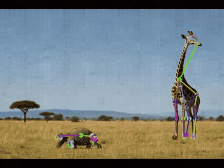
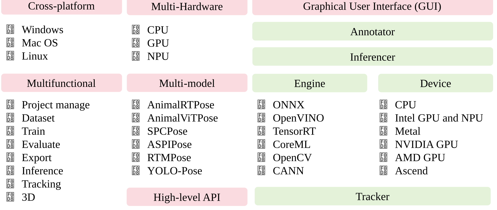
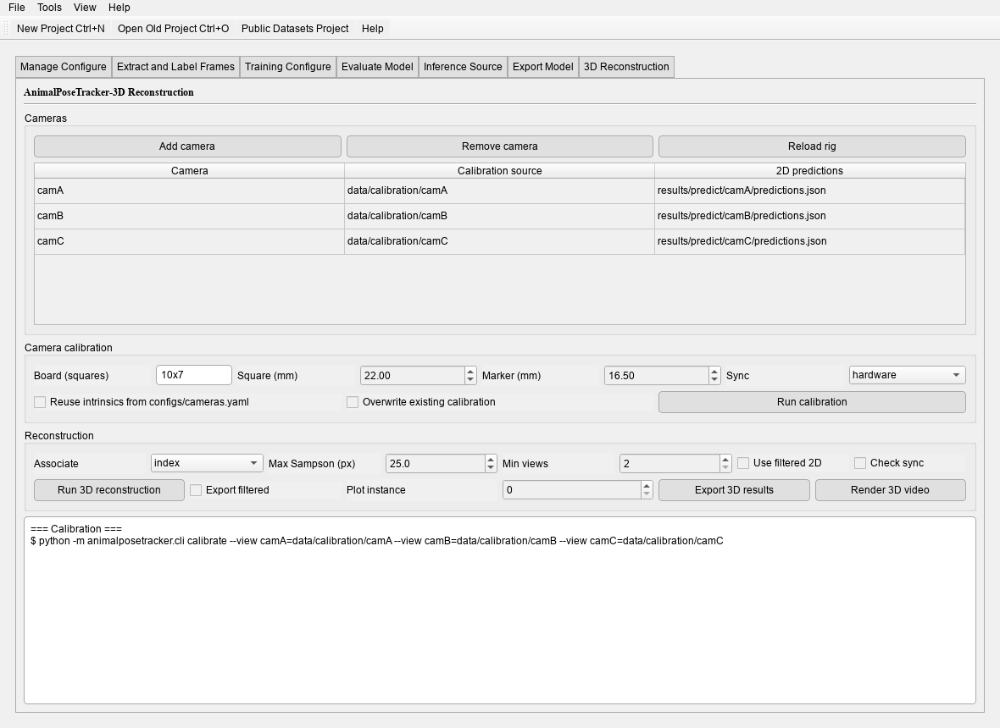

<div align="center">



  

<a href="docs/getting_started.md">📚 Documentation</a> |
<a href="#installation">🛠️ Installation</a> |
<a href="#quick-start">🚀 Quick start</a> |
<a href="#multi-camera-3d">🎯 3D</a> |
<a href="#desktop-applications">🖥️ GUI</a> |
<a href="https://github.com/wux024/AnimalPoseTracker/issues">🪲 Reporting Issues</a>

<a href="#get-assistance">🫶 Getting Assistance</a> |
<a href="#references--citations">📝 Publications</a> |
<a href="docs/deployment_formats.md">📦 Deployment formats</a> |
<a href="https://github.com/wux024/AnimalPoseTracker">💻 Source</a>

<a href="https://github.com/wux024/AnimalPoseTracker/actions/workflows/docs.yml"></a>


<a href="https://github.com/wux024/AnimalPoseTracker/stargazers"></a>


</div>

# Welcome! 👋

**AnimalPoseTracker** is a toolbox for markerless pose estimation of animals performing
various behaviors. As long as you can see (label) what you want to track, you can use this
toolbox, as it assumes no particular species, viewpoint, or camera count.
<a href="#why-another-pose-tracker">Read a short development and application summary below</a>.

# Installation

Please follow [Getting started](docs/getting_started.md) — it covers the conda environment,
matching the PyTorch build to your hardware, and installing only the extras for the engine
you deploy with. Python 3.10 or newer is required.

## Quick start

From an empty folder to an exportable model in two steps. The install above is assumed.

- [1] Create a project and train it:

```bash
animalpose-cli create --dataset trimouse --workspace projects --name smoke --worker user \
    --model AnimalRTPose --scale N --date demo --epochs 100 --batch-size 8 --image-size 640
animalpose-cli train --config projects/smoke-user-AnimalRTPose-N-demo/configs/runtime.yaml
```

- [2] Evaluate it, then export the checkpoint:

```bash
animalpose-cli val --config <project>/configs/runtime.yaml \
    --weights <project>/results/train/weights/best.pt
animalpose-cli export --config <project>/configs/runtime.yaml \
    --weights <project>/results/train/weights/best.pt --format onnx --dynamic --opset 17
```

`create` saves only what you pass; everything else keeps the model profile's defaults.
`load` validates a project and prints a summary without opening the GUI or writing files.
Command-line values override `configs/runtime.yaml` for that run and are never written back.

# Documentation: The AnimalPoseTracker Process



`animalpose-cli --help` lists all ten workflows. `animalposetracker`,
`animalpose-annotator` and `animalpose-inferencer` open the three windows; the inferencer also
runs an exported engine (`.onnx`, `.engine`, `.mlpackage`, ...) without a project.

| Step | Command | What you get |
|---|---|---|
| 1. Create | `animalpose-cli create` | Four configs, empty dataset layout |
| 2. Label | `animalpose-annotator` | Boxes, classes, keypoints, skeleton |
| 3. Train | `animalpose-cli train` | `best.pt`, `training.jsonl`, `results.png` |
| 4. Evaluate | `animalpose-cli val` | `metrics.json` — AP, AR, PCK, AUC, EPE |
| 5. Predict | `animalpose-cli predict` | `predictions.json`, rendered video |
| 6. Infer | `animalpose-cli infer` | Live overlay from camera or stream |
| 7. Export | `animalpose-cli export` | `<model>.<format>` + `.json` sidecar |
| 8. 3D | `animalpose-cli calibrate` | Rig intrinsics and extrinsics (ChArUco) |
|  | `animalpose-cli pose3d` | `results/pose3d/...csv` — 3D keypoints |
|  | `animalpose-cli pose3d-render` | 3D video, trajectory plot, summary |

Every command takes `--help`; the flags used most often are in
[Getting started](docs/getting_started.md).

Steps 1–10 are detailed in [Getting started](docs/getting_started.md); the desktop route
through the same steps is in [Desktop applications](docs/gui.md).

# Usage demo

One run end to end on a built-in dataset — create, train, predict — and the files each
step leaves behind. [Walk through it](docs/demo.md).

# Why another pose tracker?

It continues to be actively maintained, and it aims at a usable `CLI` and `GUI` for
computer-vision researchers and life scientists alike: state-of-the-art models under one
project format, with defaults that work before they are tuned. What sets it apart is the
breadth — one project trains, validates, predicts, exports and reconstructs in 3D, rather
than handing you a model and leaving the rest to glue code.

Reading the two papers below is the shortest way to see what each model is for and how to
adapt it to your setting.

## Performance 🔥

**AnimalRTPose** on AnimalPose, 640 x 640 input (Neural Networks, 2025):

| Model | AP<sub>50:95</sub> | AR<sub>50:95</sub> | Params |
|---|---|---|---|
| AnimalRTPose-N | 72.0 | 80.0 | 2.9 M |
| AnimalRTPose-S | 76.0 | 83.4 | 9.8 M |
| AnimalRTPose-M | 77.2 | 83.9 | 25.3 M |
| AnimalRTPose-L | 77.8 | 84.4 | 47.9 M |
| AnimalRTPose-X | 80.1 | 87.3 | 74.8 M |

Inference latency on NVIDIA GPUs, in milliseconds:

| Model | RTX 2080 Ti | RTX 3090 | A800 |
|---|---|---|---|
| AnimalRTPose-N | 2.1 | 1.3 | 0.9 |
| AnimalRTPose-S | 3.6 | 2.5 | 1.3 |
| AnimalRTPose-M | 7.5 | 4.9 | 2.4 |
| AnimalRTPose-L | 11.3 | 7.5 | 3.7 |
| AnimalRTPose-X | 17.1 | 11.9 | 5.6 |

The same models on edge devices:

| Model | Jetson AGX Orin | Raspberry Pi 5 + AI HAT+ | Atlas 200I |
|---|---|---|---|
| AnimalRTPose-N | 5.1 | 13.0 | 15.6 |
| AnimalRTPose-S | 5.0 | 22.0 | 26.5 |
| AnimalRTPose-M | 6.3 | 33.2 | 53.2 |
| AnimalRTPose-L | 7.5 | 49.3 | 105.7 |
| AnimalRTPose-X | 9.1 | 74.1 | 162.6 |

**AnimalViTPose** on AP10K, 256 x 256 input (EAAI, 2026):

| Model | AP<sub>50:95</sub> | AR | PCK | EPE | Latency |
|---|---|---|---|---|---|
| AnimalViTPose-S | 70.2 | 72.5 | 73.0 | 25.35 | 45.5 ms |
| AnimalViTPose-B | 78.3 | 79.7 | 79.6 | 20.03 | 49.0 ms |
| AnimalViTPose-L | 82.4 | 84.4 | 83.9 | 16.56 | 86.8 ms |
| AnimalViTPose-H | 83.9 | 87.7 | 88.2 | 15.19 | 119.6 ms |

Across the other evaluation sets:

| Dataset | Model | AP | AR |
|---|---|---|---|
| ATRW (tiger) | AnimalRTPose-N | 82.8 | 89.0 |
| TopViewMouse-5K | AnimalRTPose-L | 83.2 | 87.0 |
| AP10K | AnimalRTPose-X | 65.1 | 74.4 |
| Animal Kingdom | AnimalRTPose-X | 51.5 | 69.0 |

## Models

- **AnimalRTPose** — single-stage, real-time; predicts boxes and keypoints in one pass, so it
  runs without a detector. N/S/M/L scales.
- **AnimalViTPose** — top-down ViT with a SimCC head; crops each instance from an annotated
  or detected box and maps the prediction back. Small/Base/Large/Huge.
- Both train through the same loop, CLI, validator and export path; **RTMO** is supported as
  an additional one-stage family.

## The history

AnimalRTPose ([Neural Networks, 2025](https://doi.org/10.1016/j.neunet.2025.107685)) made
cross-species real-time pose affordable on a single GPU. AnimalViTPose
([EAAI, 2026](https://doi.org/10.1016/j.engappai.2025.112749)) added a feature-map
orthogonal decomposition decoder that lifts accuracy without giving up the deployment path.
This repository is the system that grew around the two: one project format, one trainer, one
record schema, and the 3D stage that reuses it.

### Ecosystem

The same lineage is available where it was first published:

- [AnimalRTPose configs](https://github.com/wux024/ultralytics/tree/animalrtpose/configs) — the ultralytics fork the one-stage model was trained in
- [AnimalViTPose configs](https://github.com/wux024/mmpose/tree/main/configs/animal_2d_keypoint/animalvitpose) — the MMPose config for the ViT model
- [SPCPose](https://github.com/wux024/SPCPose) — pose estimation from a single-pixel camera
- [AdamPose](https://github.com/wux024/AdamPose) — motion parameters from tracked keypoints

# Multi-camera 3D

Calibrate a rig, triangulate each camera's 2D records, and render the result:

```bash
animalpose-cli calibrate --view camA=frames/camA --view camB=frames/camB \
    --board-squares 10x7 --square-size 22 --marker-size 16.5
animalpose-cli pose3d --config configs/runtime.yaml --association epipolar
animalpose-cli pose3d-render --config configs/runtime.yaml --video both
```

`epipolar` matching keeps identities when detection order changes or two animals cross.
`--video overlay` projects the 3D keypoints back onto each camera — a correct rig lands the
skeleton on the animal, a wrong one slides off. The whole stage, including the GUI tab and
how to add 3D to an existing project, is in [Multi-camera 3D](docs/three_d.md).



# Desktop applications

| Window | Command | Purpose |
|---|---|---|
| Workspace | `animalposetracker` | Project management, frame extraction, training, evaluation, prediction, export, 3D |
| Annotator | `animalpose-annotator` | Boxes, classes, keypoints and skeleton |
| Inferencer | `animalpose-inferencer` | An exported artifact on a camera, video or stream |

The windows read and write the same files as the CLI, so a run started in one can be
continued in the other. Walkthroughs and screen recordings: [Desktop applications](docs/gui.md).

# Documentation

| Document | Contents |
|---|---|
| [Getting started](docs/getting_started.md) | Installation, CLI workflows, configuration model, datasets, project layout |
| [Multi-camera 3D](docs/three_d.md) | Calibration, triangulation, association, rendering, GUI tab |
| [Desktop applications](docs/gui.md) | The three windows, in the order you use them |
| [Configuration reference](docs/configuration.md) | Every registered key (generated from the schema) |
| [Deployment formats](docs/deployment_formats.md) | Export/prediction format matrix and per-format extras |
| [Pose analysis workflows](docs/pose_analysis_workflows.md) | Tracking/filtering API and multi-camera triangulation API |
| [Example project](docs/project_config_example/project.yaml) | A complete project configuration |

# Get assistance

| Where | For | Expectation |
|---|---|---|
| [GitHub Issues](https://github.com/wux024/AnimalPoseTracker/issues) | Bugs, feature requests | Please include the command, the config and the traceback |
| [Discussions](https://github.com/wux024/AnimalPoseTracker/discussions) | Usage questions, setups that work | Community answers |
| wux024@nenu.edu.cn | Collaboration, dataset questions | Best effort |

## References & citations

If you use this toolbox, please cite the two papers whose models it implements:

```bibtex
@article{Wu2026,
   title = {Cross-species animal pose estimation via feature map orthogonal decomposition decoder},
   journal = {Engineering Applications of Artificial Intelligence},
   volume = {163},
   pages = {112749},
   year = {2026},
   doi = {https://doi.org/10.1016/j.engappai.2025.112749},
   author = {Xin Wu and Yanmei Wang and Lianming Wang and Jipeng Huang},
   keywords = {Animal pose estimation, Vision transformer, Feature map decomposition}
}
@article{Wu2025,
   title = {AnimalRTPose: Faster cross-species real-time animal pose estimation},
   journal = {Neural Networks},
   volume = {190},
   pages = {107685},
   year = {2025},
   issn = {0893-6080},
   doi = {https://doi.org/10.1016/j.neunet.2025.107685},
   author = {Xin Wu and Lianming Wang and Jipeng Huang},
   keywords = {Animal pose estimation, Real-time, Cross-species, Lightweight network}
}
```

**Pose estimation beyond RGB.** The same group carries the problem into sensing regimes where
a camera is not an option:

- Wu, X., Zhou, C., Li, B., Huang, J., Meng, Y., & Song, L. (2025). [Cross-species pose estimation via ultra-low compression ratio array-light-based single-pixel imaging](https://doi.org/10.1016/j.optlaseng.2025.109198). *Optics and Lasers in Engineering*, 194, 109198.
- Wu, X., Zhou, C., Li, B., Huang, J., Meng, Y., Song, L., & Han, S. (2025). [Image-free cross-species pose estimation via ultra-low sampling rate single-pixel camera](https://doi.org/10.3788/COL202523.091101). *Chinese Optics Letters*, 23(9), 091101.
- Liu, Y., Wu, X., Zhou, C., Yao, D., Zhang, Q., Huang, J., Meng, Y., & Song, L. (2026). [Image-free three-dimensional human pose estimation based on single-pixel imaging with extremely low sampling rate](https://doi.org/10.1016/j.optlaseng.2026.109715). *Optics and Lasers in Engineering*, 201, 109715.

**Where the pose records go next.** 3D motion parameters and behaviour read off tracked
keypoints:

- Wu, X., Wang, Y., Chen, L., Zhang, L., & Wang, L. (2022). [Motion parameters measurement of user-defined key points using 3D pose estimation](https://doi.org/10.1016/j.engappai.2022.104667). *Engineering Applications of Artificial Intelligence*, 110, 104667.
- Wu, X., Huang, J., & Wang, L. (2024). [Pose estimation-based visual perception system for analyzing fish swimming](https://doi.org/10.1109/JSEN.2024.3374236). *IEEE Sensors Journal*, 24(8), 13293–13303.
- 王连明, 吴鑫 (2023). [基于姿态估计的物体3D运动参数测量方法](http://jlgy.publish.founderss.cn/thesisDetails#10.13229/j.cnki.jdxbgxb.20210981&lang=zh). *吉林大学学报（工学版）*, 53(7), 2099–2108.

More on [the author's homepage](https://wux024.github.io).

## License

[AGPL-3.0-or-later](LICENSE). This toolbox builds on several open-source implementations;
the code comments mark the origin of the corresponding modules, and the project is released
under the same license family those modules require.

## Versions

- **0.1.0** (2026-10) — first public version: two model families, ten CLI workflows, three
  desktop applications, export matrix, multi-camera 3D with rendering.

# News

- **2026-10** — 0.1.0. Multi-camera 3D stage: ChArUco calibration, epipolar instance
  association, reprojection and revolving 3D videos.
- **2026-10** — Export sidecars: every artifact ships the preprocessing, NMS and class
  contract the inferencer verifies before decoding.
- **2026-10** — Tracking and temporal filtering run on pose records, so a recorded sequence
  can be replayed with another tracker without re-running the network.
