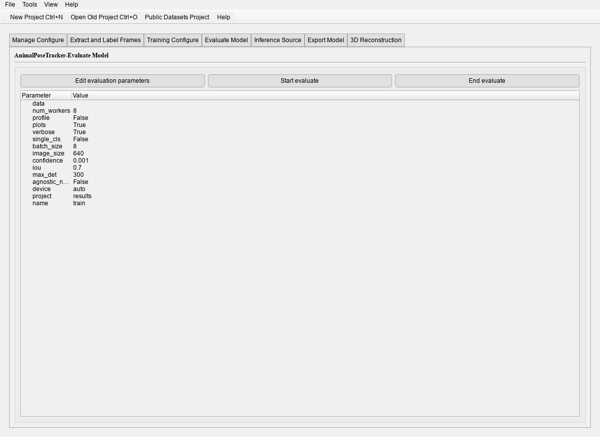

# Training and evaluation

The **Train** and **Evaluate** tabs are the desktop equivalents of `animalpose-cli train` and
`animalpose-cli val`.

## The training form

| Field | Meaning |
|---|---|
| Model / scale | fixed by the project; shown read-only |
| Epochs | upper bound — early stopping can end the run sooner |
| Batch size | per-device batch; lower it when the GPU runs out of memory |
| Image size | square input; smaller is faster and less accurate |
| Device | `0`, `0,1` for multi-GPU, or CPU |
| Workers | dataloader processes |
| Freeze | freeze the backbone for the first N epochs |

Everything else — optimizer, learning rate, augmentation, early stopping patience — comes from
`configs/runtime.yaml`. The form shows the values it will use, so a hand-edited key is visible
before the run starts.

## Curves and logs

While the run goes, the tab streams the console and paints the loss and metric curves. The
same numbers are written to:

- `results/train/training.jsonl` — one record per epoch, machine-readable;
- `results/train/results.png` — the curves, re-written at the end;
- `results/train/weights/best.pt` and `last.pt`.

Early stopping is a normal completion: the process exits 0 and `best.pt` is final. A run that
stops early is not a failed run.

## Validation metrics

The **Evaluate** tab loads a checkpoint and reports on the validation split:

| Metric | Reading |
|---|---|
| AP / AR | keypoint average precision and recall over OKS thresholds |
| PCK | correct keypoints within a fraction of the instance scale |
| AUC | area under the PCK curve |
| EPE | end-point error in pixels |

The per-keypoint breakdown is the useful part: one landmark with a much lower AP is where the
labels or the crop need attention.

## What to do with a weak metric

1. Look at the per-keypoint AP — a single bad landmark is usually a labelling problem.
2. Render predictions for a few frames and watch where the skeleton slides off.
3. Relabel those frames, retrain from `best.pt` with a frozen backbone for the first epochs.

The full loop is Phase 5 of the [User guide](../main-workflows/user-guide.md).
