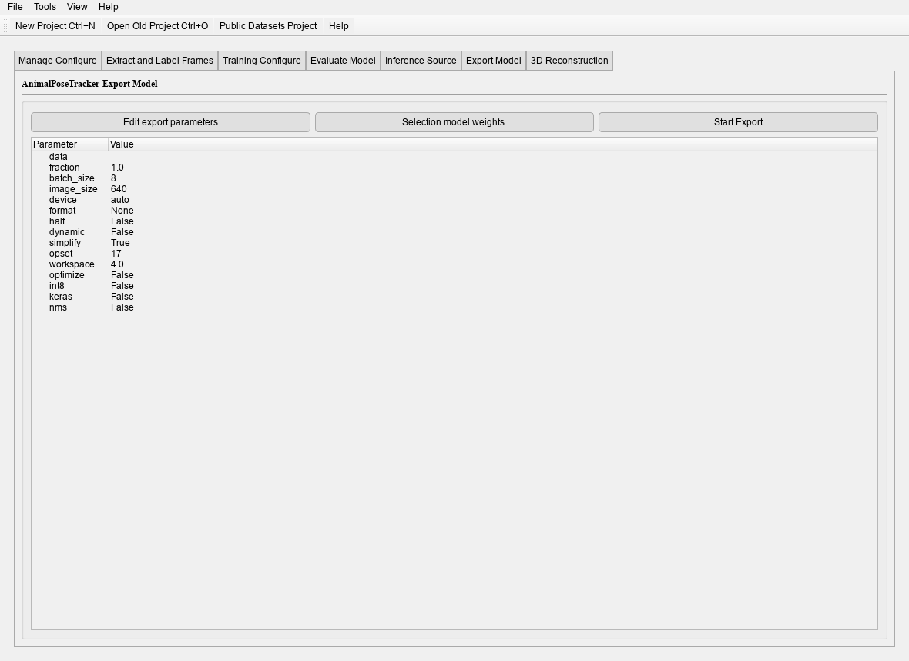

# Video analysis and export

The last three tabs: **Predict**, **Export**, and — for 3D projects — **3D Reconstruction**.

## Predict

Pick a checkpoint and a source (video, folder, or the test split), then set the thresholds.
The tab runs the same code as `animalpose-cli predict`:

- `predictions.json` — per-frame keypoints and scores;
- rendered frames or a video — the overlay;
- optionally a tracked and a filtered record file.

Use the test split when you want a number that matches `val`; use a video when you want to see
how the model behaves on material it has never seen.

## Export

Pick the format and the tab calls the same exporter the CLI uses. Each artifact lands with a
`.json` sidecar that records the preprocessing, NMS and class contract.



The format list is the [deployment matrix](../recipes/DeploymentFormats.md); only the row you pick needs
its extra installed.

## The inferencer

For a deployed artifact, `animalpose-inferencer` runs it without a project:

```bash
animalpose-inferencer
```

It accepts an ONNX, OpenVINO, TensorRT, CoreML, CANN or OpenCV artifact, a camera, a video or
a stream, and writes `results/inference/records.json` plus a rendered video. The full guide is
[Inferencer](../live/gui/index.md).

## The 3D Reconstruction tab

The tab appears only for a project created with the 3D option. Each row is a camera; double
click a cell to pick that camera's calibration folder or video and its predictions file. The
tab then runs `calibrate`, `pose3d` and `pose3d-render` with the live output in the page.

The commands it runs are the CLI's own — the tab only collects paths and numbers. What each
one does, and how to check the result, is in [3D AnimalPoseTracker](../Overviewof3D.md).
