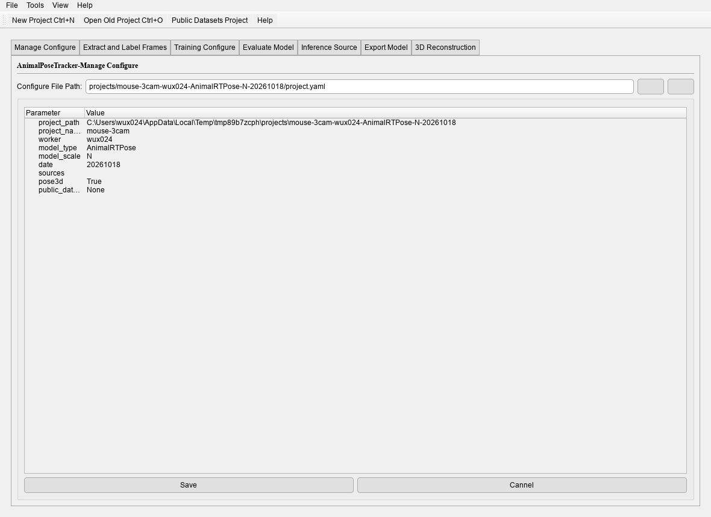
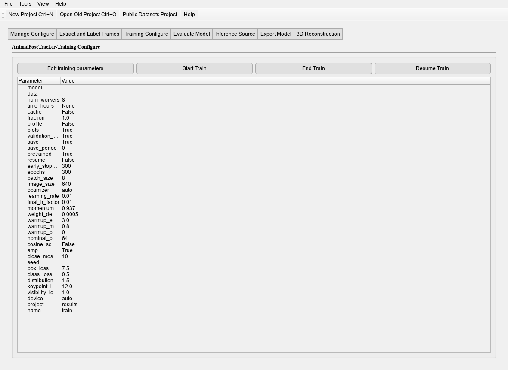

# Desktop applications

AnimalPoseTracker ships three windows: the project workspace, the annotator and the
deployed-model inferencer. They share the same project files and the same result layout as
the CLI, so a run started in one can be inspected or continued in another.

| Window | Command | Purpose |
|---|---|---|
| Workspace | `animalposetracker` | Create/load a project, extract frames, train, evaluate, predict, export, 3D |
| Annotator | `animalpose-annotator` | Draw boxes, classes, keypoints and skeleton |
| Inferencer | `animalpose-inferencer` | Run an exported artifact on a camera, video or stream |

## Train and test a model

1. Activate the environment and start the workspace: `animalposetracker`.
2. Create a new project (your own dataset or a public benchmark), or load an existing one.

   https://github.com/user-attachments/assets/156b6e16-5660-4c81-b14b-73120b67417a

   https://github.com/user-attachments/assets/7c850634-9aef-4b72-95f3-1b11c491a25c

3. Manage the project configuration, extract frames from videos (automatic or manual), and
   label poses with `animalpose-annotator`.

   https://github.com/user-attachments/assets/c48b6511-7979-4a84-ac59-b9ba4d6edebe

   https://github.com/user-attachments/assets/61662bd7-4ee4-4266-92f1-6f22bedcac3b

   https://github.com/user-attachments/assets/6ec6ac35-b6c9-41ee-8107-403861ec054a

4. Train with the training configuration.

   https://github.com/user-attachments/assets/79636a6e-3813-40f1-8595-06040e2fe178

   

5. Evaluate on the test set, then predict on videos or the `test` split. For deployed
   artifacts use `animalpose-inferencer`.

   https://github.com/user-attachments/assets/f352d5fe-1303-4070-b810-b26769faab28

   https://github.com/user-attachments/assets/ba5d9c05-73ec-44ae-b4b1-8100f02f1998

6. Export the trained model to an inference engine.

   https://github.com/user-attachments/assets/4abf70c0-e277-4860-ae12-a87e3051a3c8

The **3D Reconstruction** tab appears only for a project created with the 3D option; see
[Multi-camera 3D](three_d.md) for what it does.

## Inference on videos and cameras

1. Start the inferencer: `animalpose-inferencer`.
2. Pick the configuration file and the poser weights; the available engines and devices
   appear automatically.

   https://github.com/user-attachments/assets/db726dd8-a092-40e3-94ea-e3d423973a03

3. Enable camera or video input, pick a local video or a camera, and preview it.

   https://github.com/user-attachments/assets/007caeb6-b5b2-48a8-9873-58ff9db002b7

4. Set camera parameters (resolution, FPS, model bits, engine, device) — the camera must
   support the chosen resolution and FPS.

   https://github.com/user-attachments/assets/e67da907-e765-4247-affb-b85563a33d28

5. Start inference and tune the run controls: confidence, visualization, tracking and
   filtering.

   https://github.com/user-attachments/assets/0b57bba6-9ed6-47b1-9f4f-1d449762c784

   https://github.com/user-attachments/assets/9d2ad685-7201-4488-a653-500a6c72b3bf

### Configuration checks

The configuration file describes the classes and keypoints. Either style is accepted: a
project yaml (`classes_name` / `keypoints_name` / `skeleton`) or a dataset yaml (`names` /
`kpt_shape` / `skeleton`). These keys are not only labels — their counts tell the decoder how
the model's output tensor is laid out, so a configuration that disagrees with the artifact
shifts the keypoint block and decodes nonsense. Both files are checked as soon as they are
picked:

- missing class names or keypoint count: a message names the missing key, and Start stays
  disabled;
- keypoint count disagrees with the artifact metadata: a warning is printed and the run is
  still allowed, because the decoder follows the configuration;
- AnimalViTPose SimCC artifacts are refused at selection — this window infers YOLO-Pose
  layouts only; run those through `animalposetracker predict`.

### Tracking, filtering and records

- **Track** — tick `Track` and pick a tracker; every label then carries its track id
  (`#1 mouse: 0.90`). The list is the same one `infer --tracker` accepts, and a tracker
  follows the pose records rather than the pixels, which is why the same run can be replayed
  later with another algorithm.
- **Records** — the per-frame pose records are saved with every run to
  `results/inference/records.json`, in the same `[{frame, predictions}, ...]` shape
  `infer --records` writes, with a `track_id` on every detection when tracking was on.
  There is no switch for it: the records are the run's result. `Save Video` writes the
  rendered frames to `results/inference/output.avi`.
- **Filter** — tick `Filter` and choose a method (`median` or `savgol`) with its window,
  order, confidence and gap settings. Smoothing runs over the whole sequence when the run
  ends; the records file holds the smoothed records. Filtering needs track ids, so the
  filter controls stay disabled until `Track` is ticked, exactly as `--pose-filter` requires
  `--tracker` on the command line.

## Annotate poses

1. Start the annotator: `animalpose-annotator`.
2. Choose the configuration file and the images directory.

   https://github.com/user-attachments/assets/7d820fbe-390e-4387-9678-ac229e930cda

3. Draw bounding boxes, choose the object class, draw keypoints and skeleton, then save or
   export the annotations.

   https://github.com/user-attachments/assets/a22b28df-4b12-48b0-a087-4ab07f6ea17f
